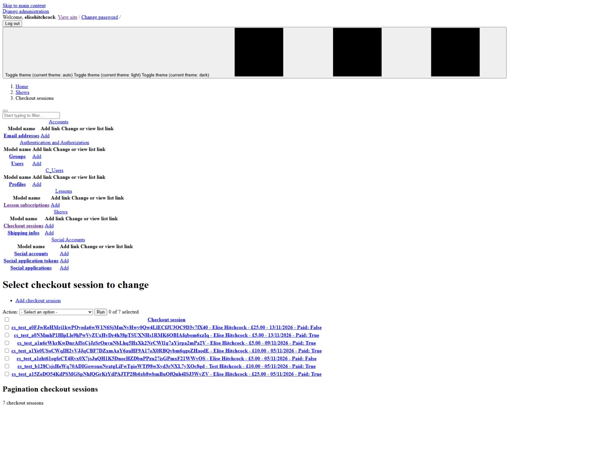
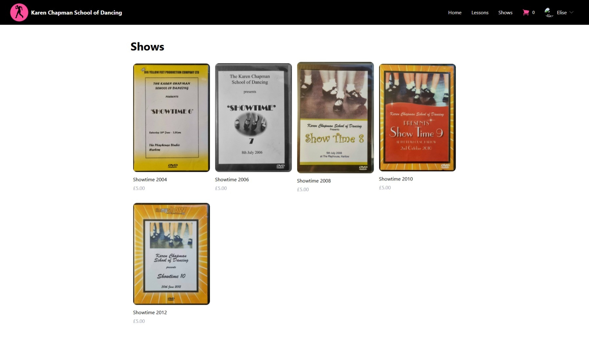
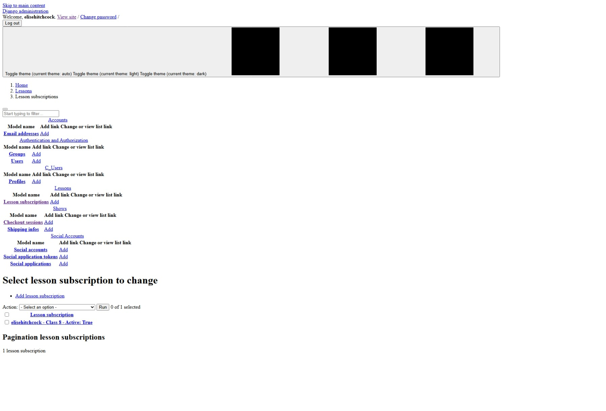
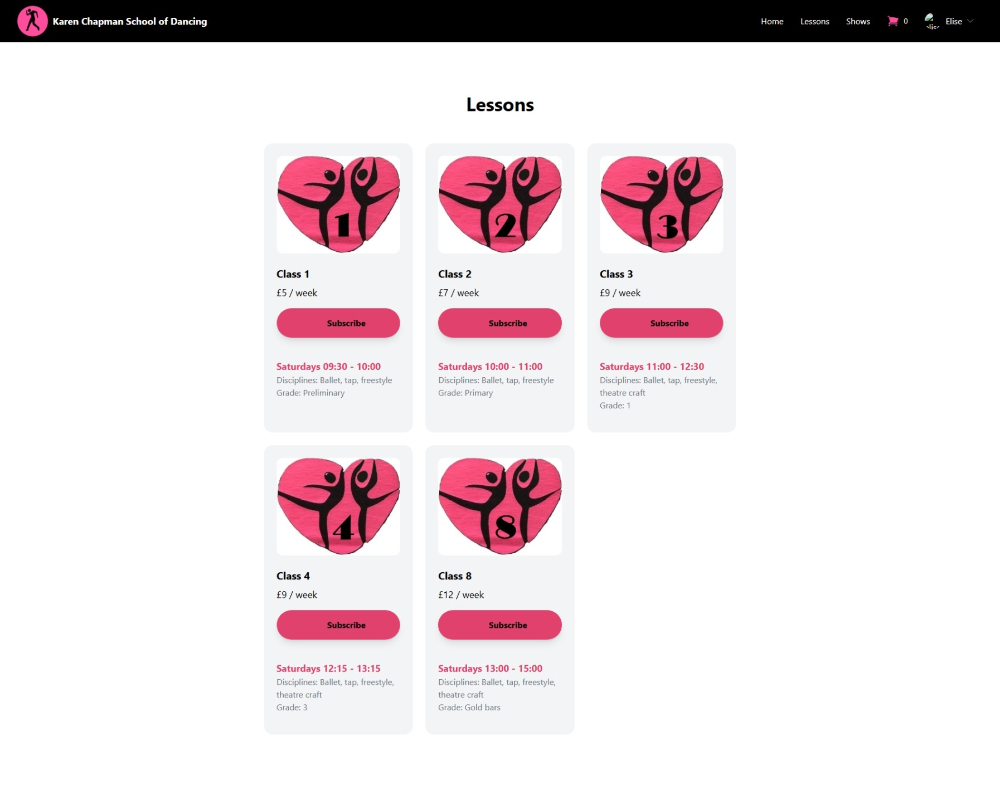

# UDP5WA4CF-UN04 Full stack frameworks with Django

Hello! Welcome to my README! I hope you have a lovely experience here.

This is the final project of Code Institutes' Full Stack Web Developer program via [University Centre Peterborough](https://www.ucp.ac.uk/) covering, you guessed it, full stack development. I'm making this website in the hopes of making it live and functional to assist my aunts' business.

<!-- <-- this is broken, not sure fixing Heroku live site will fix it either - regarding 2 deployments vs 1 actions [graphite github actions status](https://staging-graphite-splash.vercel.app/guides/github-actions-status) -->

---

Visit the homepage [here](https://un04-full-stack-frameworks-f3ce56f25fcf.herokuapp.com/).

<!--   
> _[Screenshot](https://ui.dev/amiresponsive?url=https://stillprocrastinating.github.io/UDP5WA4CF-UN02_interactive_front_end_development) generated using [AmIResponsive](https://ui.dev/amiresponsive)._ -->

---

## Justification

Purchasing of lessons and show recordings from the dance school: Karen Chapmans' School of Dancing. Previously, this has been done via exchange of cash or bank transfer in person. I hope that the option of offering a subscription for recurring lesson payments is helpful to many students/parents who find it difficult to keep track of which lessons they've paid for.

If this proves successful, I hope to add school uniform, exam fees, and show tickets purchasing.

### Reflections

The Heroku build logs are still daunting, but still helpful.

Stripe has really evolved, I'm proud of them. The site looks completely different from when the Code Institute course was recorded (I believe, 8 years ago); but also has made changes since 2 years ago according to the YouTube tutorials I was following by [Andreas Jud](https://www.youtube.com/channel/UCNWqvvrhtvXXXkC_Ih2lmpQ).

## Contents

1. [Introduction](https://github.com/stillprocrastinating/UDP5WA4CF-UN04_full_stack_frameworks_with_django/edit/main/README.md#udp5wa4cf-un04-full-stack-frameworks-with-django)  
    1.1. [Visit the homepage](https://un04-full-stack-frameworks-f3ce56f25fcf.herokuapp.com/)  
    1.2. [Justification](https://github.com/stillprocrastinating/UDP5WA4CF-UN04_full_stack_frameworks_with_django/edit/main/README.md#justification)  
    1.3. [Reflections](https://github.com/stillprocrastinating/UDP5WA4CF-UN04_full_stack_frameworks_with_django/edit/main/README.md#reflections)  
1. [Design]  
    2.1. [User Stories]  
    2.2. [Features]  
    2.3. [ERDs]  
    2.4. [Wireframes]  
1. [Credits]  
    3.1. [Development & deployment](https://github.com/stillprocrastinating/UDP5WA4CF-UN04_full_stack_frameworks_with_django/edit/main/README.md#development--deployment)  
    3.2. [Libraries]  
    3.3. [Accessibility]  
    3.4. [Images]  
    3.5. [Fonts]  
1. [Bugs & testing](https://github.com/stillprocrastinating/UDP5WA4CF-UN04_full_stack_frameworks_with_django/edit/main/README.md#bugs--testing)  

---

## Design

### Wireframes

_You may click on any screenshot image to be taken to the fullscreen view (and use the browser back button to return here)._

<!-- | Pages | Features | Wireframe | Presentation |
|-|-|-|-|
| index.html | On load |  |  | -->

### User Stories

Please find a comprehensive list of user story goal progress under _0\_documents_ > _README_ > _files_ > _[user_stories](https://github.com/stillprocrastinating/UDP5WA4CF-UN04_full_stack_frameworks_with_django/blob/main/0_documents/README/files/user_stories.md)_.  
TLDR as follows.

_You may click on any screenshot image to be taken to the fullscreen view (and use the browser back button to return here)._

| # | Description | Solution |
|-|-|-|
| 1 | As an admin, I want CRUD functionality for show ticket one-time purchases. |  |
| 2 | As a user, I want to be able to purchase show tickets. |  |
| 3 | As an admin, I want CRUD functionality for student lesson purchases. |  |
| 4 | As a verified user, I want to be able to purchase a subscription to dance lessons. |  |

### Features

_You may click on any screenshot image to be taken to the fullscreen view (and use the browser back button to return here)._

| Pages | Sizes | Feature | Presentation |
|-|-|-|-|
| All | All | `<noscript>` to handle disabled JavaScript | ![noscript] |
| 404.html | All | Custom 404 page to handle misdirected urls | ![404] |

### Entity relationship diagrams

Please find a comprehensive list of ERDs under _0\_documents_ > _README_ > _files_ > _[erd]_.  
TLDR as follows.

>Example

:arrow_down:

>Example

:arrow_down:

>Example

---

## Credits

Example.

### Development & deployment

This website was developed using HTML5, CSS3, JavaScript, and Python in [Visual Studio Code](https://code.visualstudio.com); SQLTools, Python, and PostgreSQL, [Visual Studio Code](https://code.visualstudio.com) extensions were also used. The terminal and source control were used to commit and push to [GitHub](https://github.com/dashboard). The code was pulled from [GitHub](https://github.com/dashboard) into [Heroku](https://id.heroku.com), which built the site.

### Libraries

Please find a comprehensive list of code used from external sources under _0\_documents_ > _[libraries]_.  

Example. <!-- explanatory text: where library code is used, whether it's modified, credit -->

### Accessibility

Please find a comprehensive list of accessibility under _0\_documents_ > _README_ > _files_ > _[accessibility]_.  
TLDR as follows.

| Object | Ratio | WCAG AA |
|-|-|-|
| [--example-dark on --color-white] | example : 1 | pass |

| Object | Method | Description |
|-|-|-|
| `.example` | `aria-example` | This is an example |

### Images

Files can be found under _1\_staticfiles_ > _images_ > _[base](https://github.com/stillprocrastinating/UDP5WA4CF-UN03_back_end_development/tree/main/1_staticfiles/images/base)_.

The original [example image] was designed by [example] and sourced from [website]. The image indicates that example. I edited the image to example so that it looked more aesthetic in my example.

#### Favicon

Files can be found under _1\_staticfiles_ > _images_ > _[favicon]_.

The favicon was generated from the [example] (sourced from [example]) using [RealFaviconGenerator](https://realfavicongenerator.net).

#### Icons

Files can be found under _0\_documents_ > _README_ > _images_ > _[icons]_.

The example image SVGs were sourced from [website].
- The example image was [example].

### Fonts

- [font]  
![font demonstration as an image]

---

## Bugs & testing

Please find a comprehensive list of bug reports under _0\_documents_ > _README_ > _files_ > _[bugs]_.  
Please also find a comprehensive list of testing under _0\_documents_ > _README_ > _tests_ > _[manual](https://github.com/stillprocrastinating/UDP5WA4CF-UN04_full_stack_frameworks_with_django/blob/main/0_documents/tests/manual.md)_.  
TLDR as follows.

| # | Date IDd | Bug description | Date resolved | Resolution | Commit | Comments |
|-|-|-|-|-|-|-|
| 2 | 2026-10-27 | Heroku live site application error log: `code=H14` | 2026-10-28 | Heroku Eco dyno ~~not~~ activated | N/A | Raghav troubleshot this fix (thank you!) |ars | N/A |
| 4 | 2026-11-02 | Heroku live site static media not loading ||| Residual bug |
| 6 | 2026-11-05 | _checkout-total.html_ `div#product-total-{{product.id}}` is not functioning without page reload |||| Residual bug |

| Datetime | Test | Expectation | Completion |
|-|-|-|-|
|| ___home\_home.html___ |||
| 2026-11-13 | Website functionality | Perfect functionality | Fail |
||| Pages load | Success |
||| CSS loads | Fail |
||| Tailwindcss loads | Success |
||| AllAuth functions | Success |
||| User is/not automatically logged in, as appropriate | Success |

---

Raghav, thank you, I really appreciate you :)

[↑ Return to top](https://github.com/stillprocrastinating/UDP5WA4CF-UN04_full_stack_frameworks_with_django/tree/main)
